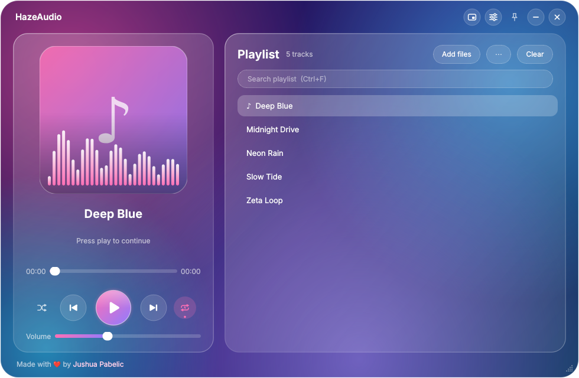
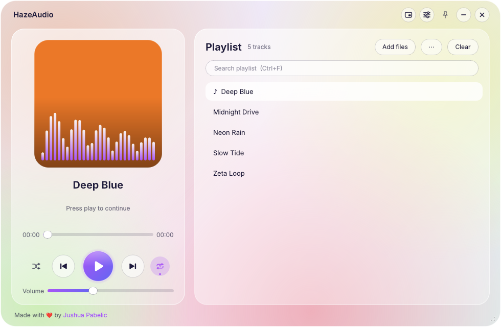

<p align="center">
  
</p>

<h1 align="center">HazeAudio</h1>

<p align="center">
  <b>A glass-smooth audio player for Windows.</b><br>
  Drag in your music and press play.
</p>

<p align="center">
  
  
  
  
</p>

<p align="center">
  
</p>

<p align="center">
  
  &nbsp;
  
</p>

<sub><i>Screenshots show the Haze theme, the light Frost theme with colors taken from album art, and the mini-player.</i></sub>

---

## Features

**Play anything, instantly**
- Drag and drop files, whole folders, or `.m3u` / `.m3u8` playlists anywhere on the window
- Plays MP3, WAV, OGG, FLAC, M4A, AAC, Opus and more (decoding is bundled, nothing to install)
- Appears in Windows **Open with** for common audio files (installer), and double-clicking a song while HazeAudio is open sends it to the running window

**Looks the part**
- Glassmorphism UI with frosted panels and soft color glows
- Live **spectrum visualizer** drawn over the album art
- **7 themes**: Haze, Ocean, Sunset, Forest, Rose, Graphite, and a light **Frost** theme
- Optional **colors from album art**: the background glows shift to match each cover

**Stays out of your way**
- **Mini-player**: a small always-on-top glass bar
- **System tray**: close the window and the music keeps playing
- **Global media keys** (Windows): play/pause, next, previous from your keyboard in any app
- Keep-on-top pin, sleep timer with a gentle fade-out, soft fades on pause and resume

**A playlist that behaves**
- Drag rows to reorder, search with `Ctrl+F`, sort A to Z
- Right-click a track: Play, Play next, Show in folder, Remove
- Open and save M3U playlists
- Shuffle and repeat (off / all / one track), output-device picker

**Remembers everything**
- Playlist, current track **and position**, volume, theme, window position and all settings

## Download

Grab the latest build from the **[Releases page](../../releases/latest)**:

| File | What it is |
|------|------------|
| `HazeAudio-Setup-x.y.z.exe` | Installer with Start-menu entry and "Open with" support |
| `HazeAudio` folder (zip) | Portable: unzip anywhere and run `HazeAudio.exe` |

> **Windows SmartScreen:** the app is not code-signed yet, so Windows may warn about an unknown publisher on first run. Choose **More info → Run anyway**.

## Using HazeAudio

Drop audio files or folders onto the window. The first track starts playing automatically.

| Key | Action |
|-----|--------|
| `Space` | Play / pause |
| `←` / `→` | Seek 5 seconds |
| `↑` / `↓` | Volume |
| `Delete` | Remove the selected track |
| `Ctrl` + `F` | Search the playlist |
| Media keys | Play/pause, next, previous (global on Windows) |

The title bar has the **mini-player** (▭), **settings** (⚙: themes, output device, sleep timer, tray and media-key options), **keep on top** (📌), minimize and close.

## Run from source

You need **Windows 10/11 (64-bit)** and **Python 3.12**. The code is plain PySide6, so it should also run from source on macOS and Linux, but Windows is the supported target.

```bash
pip install -r requirements.txt
python haze_audio.py
```

## Build the app yourself

**Option 1: on your PC.** Install Python 3.12 (tick "Add python.exe to PATH") and double-click `build.bat`.
It creates a virtual environment, installs the pinned dependencies, and produces `dist\HazeAudio\HazeAudio.exe`.
If [Inno Setup 6](https://jrsoftware.org/isinfo.php) is installed, it also builds `installer\HazeAudio-Setup-<version>.exe`.

**Option 2: in the cloud.** On GitHub open **Actions → Build Windows app → Run workflow**.
Download the `HazeAudio-Windows` artifact when it finishes. No Python needed on your machine.

### Notes for maintainers
- The first build writes `requirements.lock` with exact versions. **Commit it.** Later builds use it, so the app builds the same way years from now.
- To upgrade dependencies: edit `requirements.txt`, delete `requirements.lock`, rebuild, test, commit the new lock.
- To release: bump `VERSION` in `haze_audio.py` and `AppVersion` in `installer.iss`, build, then attach the installer and a zip of `dist\HazeAudio` to a new GitHub Release. Pushing a `v*` tag also runs the build workflow.

## Project layout

```
haze_audio.py        the whole app (UI, playback, visualizer, tray, settings)
requirements.txt     dependency ranges (requirements.lock is created on first build)
build.bat            one-click Windows build
installer.iss        Inno Setup installer script
icon.ico             app icon
docs/                README images
.github/workflows/   cloud build
```

## How it works

- **UI:** [Qt for Python (PySide6)](https://doc.qt.io/qtforpython-6/). The glass look is painted by the app itself (gradients, glow blobs, translucent cards), so it looks the same on any machine and needs no OS blur effect.
- **Playback:** Qt Multimedia's `QMediaPlayer` with the bundled FFmpeg backend.
- **Visualizer:** decoded audio buffers from `QAudioBufferOutput` go through a small pure-Python FFT, synced to the playback position. No NumPy, which keeps the app small.
- **Settings:** JSON in `%APPDATA%\HazeAudio\state.json`. Unexpected errors are logged to `%APPDATA%\HazeAudio\error.log`.

## Known limitations

- No equalizer, crossfade or gapless playback. Qt's player offers no audio-processing hooks, so these would need a different audio engine.
- Global media keys claim Play/Pause/Next/Previous system-wide while HazeAudio runs. Turn them off in **⚙ Settings** if another app should keep them.
- Not code-signed yet (SmartScreen warning, see above).

## Roadmap

- [ ] Equalizer and gapless playback (new audio engine)
- [ ] Windows "Now Playing" overlay integration
- [ ] Update checker
- [ ] Code signing

## Contributing

Issues and pull requests are welcome. When reporting a bug, please attach `%APPDATA%\HazeAudio\error.log` if it exists and say which Windows version you use.

## License

Released under the [MIT License](LICENSE). HazeAudio bundles Qt for Python (PySide6), which is licensed under the LGPL-3.0.

---

<p align="center">
  Made with ❤️ by <a href="https://github.com/Pabelic1221">Jushua Pabelic</a>
</p>
